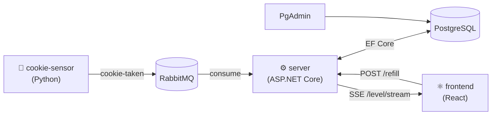

# .NET Aspire in der Praxis — DWX 2026

Talk repository for **Sven Hennessen** @ [DWX Developer World 2026](https://www.developer-week.de), 30. Juni 2026.

> **Von lokaler Entwicklung bis zum Deployment** — Hands-on mit .NET Aspire 13.4: AppHost, Deployment-Targets, Custom Pipeline Steps, und Aspire MCP.

## Repository structure

| Path | What's in it |
|---|---|
| `slides/` | HTML slide deck (`slides-dwx.html`) — open in a browser, navigate with arrow keys, press `S` for speaker notes |
| `src/` | The CookieJar demo application (Aspire AppHost + all services) |
| `deploy/` | Deployment scripts and generated artifacts for Docker Compose, Kubernetes, and Kamal |

## The demo — CookieJar

A small distributed application that tracks the fill level of the office cookie jar in real time. It intentionally uses three languages and runtimes to demonstrate Aspire's tech-stack independence.



| Component | Technology | Role |
|---|---|---|
| `cookie-sensor` | Python + pika | Simulates cookies being taken; publishes events to RabbitMQ every 2–10 s |
| `server` | ASP.NET Core + EF Core | Consumes events, persists fill level to PostgreSQL, streams updates via SSE |
| `frontend` | React + Vite | Displays fill level live; button to refill |
| `messaging` | RabbitMQ | Queue: `cookie-taken` |
| `postgres` | PostgreSQL + PgAdmin | Persistent state |

## Running locally

```sh
cd src
dotnet run --project CookieJar.AppHost
```

Aspire will start all resources, run database migrations, and open the dashboard automatically.

## Deployment

Docker Compose, Kubernetes (Helm), and Kamal deployment are covered in [deploy/README.md](deploy/README.md).

## Configuration

### RabbitMQ password (secret)

Required. Set via `dotnet user-secrets` in the AppHost project — never committed to source control.

```sh
dotnet user-secrets set "Parameters:rabbitmq-password" "<password>" \
  --project src/CookieJar.AppHost
```

### Cookie jar capacity (plain parameter)

Maximum fill level after a refill. Defaults to `100` when not set. Override via `dotnet user-secrets` or any configuration source:

```sh
dotnet user-secrets set "Parameters:cookie-jar-capacity" "80" \
  --project src/CookieJar.AppHost
```

The value is injected into the server as the `CookieJar__Capacity` environment variable and bound to `CookieJarOptions.Capacity`.
