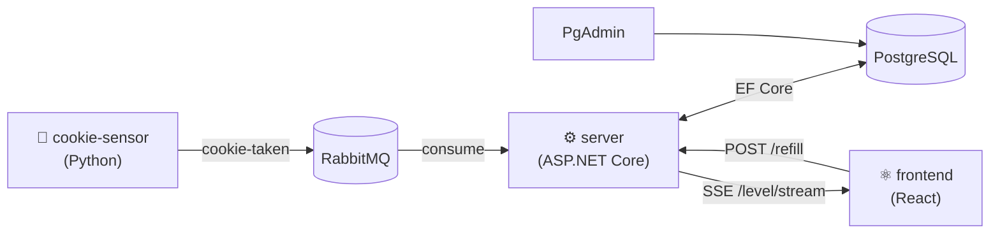

# Aspire in Practice — IT-Tage 2026

Talk repository for **Sven Hennessen** @ [IT-Tage 2026](https://ittage.informatik-aktuell.de), Frankfurt am Main — Donnerstag, 10. Dezember 2026, 09:00–09:45.

> **From local development to tests and deployment** — hands-on with Aspire 13.6: AppHost, Aspire.Hosting.Testing, deployment targets (Docker Compose, Kubernetes, Kamal via [Vensas.Aspire.Hosting.Kamal](https://github.com/vensas/aspire-hosting-kamal)) and Aspire MCP.

| Talk | Slides | Demo code |
|---|---|---|
| IT-Tage 2026 (English) | [`docs/aspire-in-practice-it-tage-2026-12-10.pdf`](docs/aspire-in-practice-it-tage-2026-12-10.pdf), source [`docs/aspire-in-practice-it-tage-2026-12-10.yaml`](docs/aspire-in-practice-it-tage-2026-12-10.yaml), [speaker notes](docs/aspire-in-practice-it-tage-2026-12-10-notes.md) | this branch (Aspire 13.6.4) |
| [DWX Developer World 2026](https://www.developer-week.de), 30. Juni 2026 (German) | `slides/slides-dwx.html` | git tag [`dwx-2026`](../../tree/dwx-2026) (Aspire 13.4.6, custom Kamal pipeline step) |

## Repository structure

| Path | What's in it |
|---|---|
| `docs/` | IT-Tage deck: YAML source, generated PDF, speaker notes, screenshots in `docs/img/` — made with [vensas-doc-generator](https://github.com/vensas/vensas-doc-generator) via `./generate-docs.sh` |
| `slides/` | DWX deck (`slides-dwx.html`) — open in a browser, navigate with arrow keys, press `S` for speaker notes |
| `src/` | The CookieJar demo application (Aspire AppHost + all services) and `CookieJar.Tests` |
| `deploy/` | Deployment scripts and generated artifacts for Docker Compose, Kubernetes, and Kamal |

## The demo — CookieJar

A small distributed application that tracks the fill level of the office cookie jar in real time. It intentionally uses three languages and runtimes to demonstrate Aspire's tech-stack independence.



| Component | Technology | Role |
|---|---|---|
| `cookie-sensor` | Python + pika | Simulates cookies being taken; publishes events to RabbitMQ every 2–10 s |
| `server` | ASP.NET Core + EF Core | Consumes events, persists fill level to PostgreSQL, streams updates via SSE |
| `frontend` | React + Vite | Displays fill level live; button to refill |
| `messaging` | RabbitMQ | Queue: `cookie-taken` |
| `postgres` | PostgreSQL + PgAdmin | Persistent state |

## Running locally

```sh
cd src
dotnet run --project CookieJar.AppHost
```

Aspire will start all resources, run database migrations, and open the dashboard automatically. The two server replicas migrate under a PostgreSQL advisory lock, so only one of them migrates at a time.

## Tests — Aspire.Hosting.Testing

`src/CookieJar.Tests` starts the real AppHost from xUnit v3 (Docker or Podman required):

```sh
dotnet test src/CookieJar.Tests
```

| Test | What it checks |
|---|---|
| `AppModelTests.*` | App model only, no containers (< 1 s): server runs 2 replicas with a health check, waits for `cookiejardb` and `messaging`, the capacity parameter reads configuration |
| `CookieJarTests.Refill_SetsLevelToCapacityParameter` | `POST /refill` returns the capacity passed in as `Parameters:cookie-jar-capacity=42` |
| `CookieJarTests.CookieTakenEvent_LowersLevel_OnBothReplicas` | A `cookie-taken` message published to RabbitMQ lowers the level, and both server replicas see it |
| `CookieJarTests.BothReplicas_MigrateUnderTheLock` | Both replicas migrate under a PostgreSQL advisory lock (`MigrateWithLockAsync`), checked through the replica console logs |
| `CookieJarTests.LevelStream_OnEveryReplica_ReceivesEveryChange` | **Explicit, fails on purpose:** SSE subscriptions are in-memory per replica, so each replica only streams the events it consumed itself |

The fixture removes PgAdmin, the frontend and the cookie sensor (incl. their npm/pip installer resources), drops the Postgres data volume, and passes parameters as arguments — no user secrets needed.

Run the explicit test to show the SSE bug:

```sh
dotnet run --project src/CookieJar.Tests -- -explicit only
```

## Deployment

Docker Compose, Kubernetes (Helm), and Kamal deployment are covered in [deploy/README.md](deploy/README.md).

## Configuration

### RabbitMQ password (secret)

Required. Set via `dotnet user-secrets` in the AppHost project — never committed to source control.

```sh
dotnet user-secrets set "Parameters:rabbitmq-password" "<password>" \
  --project src/CookieJar.AppHost
```

### Cookie jar capacity (plain parameter)

Maximum fill level after a refill. Defaults to `100` when not set. Override via `dotnet user-secrets` or any configuration source (the DWX version used `AddParameter(name, "100")`, which is a constant and silently ignored this override):

```sh
dotnet user-secrets set "Parameters:cookie-jar-capacity" "80" \
  --project src/CookieJar.AppHost
```

The value is injected into the server as the `CookieJar__Capacity` environment variable and bound to `CookieJarOptions.Capacity`.

## Slides

The IT-Tage deck is YAML for the [vensas-doc-generator](https://github.com/vensas/vensas-doc-generator), which must be checked out beside this repository (or set `DOC_GENERATOR_DIR`):

```sh
./generate-docs.sh       # docs/aspire-in-practice-it-tage-2026-12-10.yaml → .pdf
```

The screenshots in `docs/img/` are real: the Aspire dashboard and the frontend from `aspire run`, and the test output from `dotnet test` and `dotnet run --project src/CookieJar.Tests -- -explicit only`.
